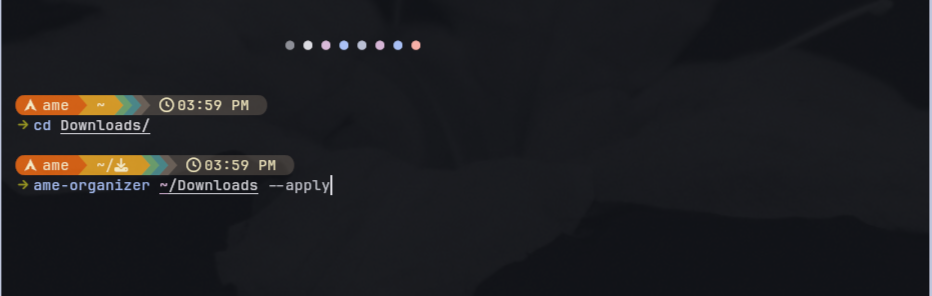

# ame-organizer



**Your Downloads folder isn’t a filing system.**

Sort your downloads into the right home folders. Preview first, choose with `y/n`, and undo a cleanup if needed.

## Get started

Requires Python 3. No extra packages. Tested on Linux with Python 3.14.

```bash
git clone https://github.com/zelda19/ame-organizer.git
cd ame-organizer
```

## Use it

Run these from the project folder:

```bash
python3 organizer.py ~/Downloads           # Preview only
python3 organizer.py ~/Downloads --select  # Choose files with y/n
python3 organizer.py ~/Downloads --apply   # Move all matched files
python3 organizer.py --undo                # Undo the last recorded cleanup
```

With `--select`, answer **`y` to approve** or **`n` / Enter to skip** each file. Files move after all questions are answered. Ctrl+C before moves begin cancels the selection.

Undo shows what it will restore and asks for `y/n` confirmation. You can also use `~/Downloads --undo`: the folder is ignored, and the last recorded cleanup is used.

Already have the `ame-organizer` launcher installed? Replace `python3 organizer.py` with `ame-organizer` to run from any folder.

## Where files go

Destinations are under your home folder, **not inside Downloads**.

| File | Destination |
|---|---|
| Documents with `resume` or standalone `cv` in the name | `~/Documents/jobs/` |
| Pictures with `screenshot` anywhere in the name | `~/Pictures/Screenshots/` |
| Pictures with `wallpaper` anywhere in the name | `~/Pictures/Wallpapers/` |
| Other supported pictures, even with random names | `~/Pictures/Photos/` |
| Other supported documents | `~/Documents/` |
| Supported audio / videos | `~/Music/` / `~/Videos/` |
| Archives, apps, and unknown file types | Left alone |

Names are matched without regard to capitalization. Routing uses filenames and extensions—not what the document says.
If a picture name contains both `screenshot` and `wallpaper`, Screenshots wins. Missing destination folders are created only when moving files.

## Before you move files

- **No overwrites:** duplicates become names like `resume (1).pdf`.
- **No digging into folders:** subfolders, hidden files, and symbolic links are skipped.
- **Undo needs history:** only recorded moves can be restored. Undo stops if files changed, went missing, were replaced, or their original paths are occupied. History is local at `~/.local/state/ame-organizer/history.sqlite3`; it is not a file backup.
- **Same filesystem only:** hard-link support is required. Destination folders cannot use symbolic links. Run one cleanup or undo at a time; don’t edit those files while it runs.
- **If interrupted:** completed steps stay completed. Retry `--undo` to recover recorded moves. Real power-loss recovery has not been verified.

## Run the tests

```bash
python3 -m unittest -v
```

Tests use temporary folders, not your personal files.
